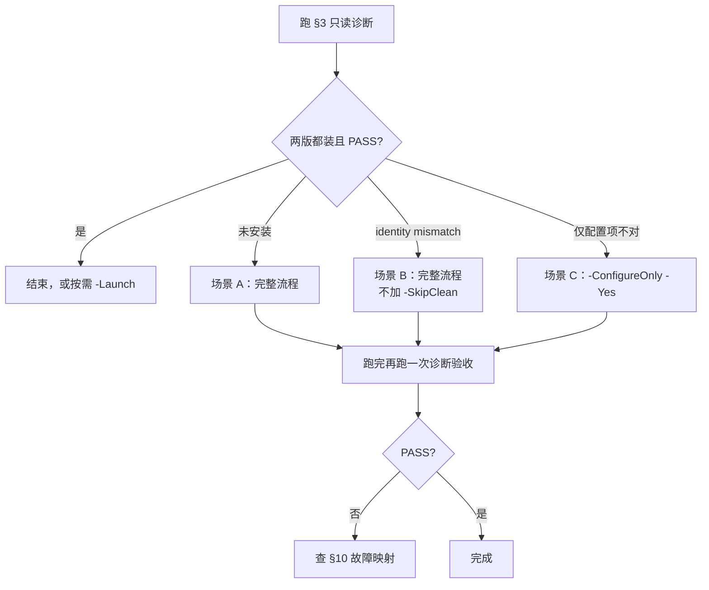

# WorkBuddy 双版并存安装（AI 执行手册）

> 本文是**可执行手册**，不是科普。目标是：任何人或 AI 读完就能判断当前状态、选对命令、执行、验收。
> 配套脚本位于 `C:\Users\cql13\Downloads\Install-WorkBuddy\`，共 3 个文件。

## 0. 30 秒速览

| 项 | 内容 |
| --- | --- |
| 目标态 | 国内版装在 `%LOCALAPPDATA%\Programs\WorkBuddy`，国际版装在 `...\Programs\WorkBuddyAI`，两边 `product.json` 各自正确 |
| 一条命令修复 | `powershell -NoProfile -ExecutionPolicy Bypass -File "<脚本目录>\Install-WorkBuddy-Dual.ps1" -Yes` |
| 动手前必须做 | 先跑 [§3 只读诊断](#3-第一步永远是只读诊断)，别跳过 |
| 只修配置 | 加 `-ConfigureOnly -Yes`（不下载、不清理、不安装） |
| 三条红线 | ① 不删 `~\.workbuddy` / `~\.workbuddy-ai` ② 不加 `-PurgeUserData`（除非用户明确要求并确认会丢登录） ③ 不把某版安装包指到另一版目录 |
| 脚本位置丢了 | 向用户索要，**不要自己重写一份**（里面的判据都是实测出来的） |

## 1. 背景：为什么"两个 exe 装一起"会出事

国内版和国际版是**同一套代码的两个构建**，靠安装目录里的一份 `product.json` 决定"我是谁"：

| | 国内版 WorkBuddy | 国际版 WorkBuddy AI |
| --- | --- | --- |
| 主程序 | `WorkBuddy.exe` | `WorkBuddyAI.exe` |
| `applicationName` | `WorkBuddy` | `workbuddy-ai` |
| `isOversea` | 无 / `false` | `true` |
| 配置目录（`dataFolderName`） | `.workbuddy` | `.workbuddy-ai` |
| 更新源（`endpoint`） | `https://www.workbuddy.cn` | `https://www.workbuddy.ai` |
| 单实例锁 | `workbuddy` | `workbuddy-ai` |
| 任务栏 AUMID | `WorkBuddy.WorkBuddy` | `WorkBuddy.WorkBuddyAI` |

`product.json` 的路径是固定的：

```text
<安装目录>\resources\app.asar.unpacked\cli\product.json
```

三条因果链，记住了就能自己排障：

1. **同目录只有一份 `product.json`** → 两个 exe 都按它跑 → 必有一个"变身"。
2. **更新等价于原地升级**：`/S --updated /UPDATE=1 /D=<自己所在目录>`。更新源一旦认成对方，就会把**自己这个目录**刷成对方版本。
3. **国内版版本号常年低于国际版**（实测 5.9.3 vs 5.9.4）→ 启动时的"强制自动更新"会再刷一次，越刷越乱。

所以稳定共存的充分条件是：**两版各在各的目录 + 各自 `product.json` 正确 + 没有全局更新源变量干扰**。脚本就是把这三件事自动化。

## 2. 环境与前置

- Windows 10 / 11 x64，PowerShell 5.1（系统自带）即可，**不需要管理员**（按用户装到 `%LOCALAPPDATA%`）。
- 需要能访问：`workbuddy.cn`、`workbuddy.ai`、`download.codebuddy.cn`、`download.codebuddy.ai`。走代理用 `-Proxy http://127.0.0.1:7890`。
- 下载优先用 `curl.exe`（Win10 1803+ 自带）；没有则回退 `Invoke-WebRequest`（脚本里设了 `-TimeoutSec 0`，即不超时）。

| 文件 | 用途 |
| --- | --- |
| `Install-WorkBuddy-Dual.ps1` | 主脚本，UTF-8 **with BOM**（PS 5.1 能正确读中文） |
| `Install-WorkBuddy-Dual.bat` | 双击启动器：`chcp 65001` + `-ExecutionPolicy Bypass` + 结束暂停 |
| `README.md` | 人读的说明文档 |

## 3. 第一步永远是只读诊断

**任何操作之前先跑这段**（纯只读、纯 ASCII 输出，PS 5.1 / pwsh 7 都能跑）：

```powershell
# Read-only diagnostic. Changes nothing.
$Expect = @{ 'CN' = $false; 'INTL' = $true }     # expected isOversea
$Dirs   = @{ 'CN'   = "$env:LOCALAPPDATA\Programs\WorkBuddy"
             'INTL' = "$env:LOCALAPPDATA\Programs\WorkBuddyAI" }
$problems = New-Object System.Collections.Generic.List[string]

foreach ($k in @('CN','INTL')) {
  $dir = $Dirs[$k]
  $pj  = Join-Path $dir 'resources\app.asar.unpacked\cli\product.json'
  Write-Host "=== $k : $dir"
  if (-not (Test-Path $pj)) { Write-Host "  [NOT INSTALLED] product.json missing"; $problems.Add("$k not installed"); continue }

  $o  = Get-Content $pj -Raw -Encoding UTF8 | ConvertFrom-Json
  $ov = $o.isOversea
  $isOversea = if ($null -eq $ov) { $false } elseif ($ov -is [bool]) { $ov } else { ([string]$ov).ToLower() -eq 'true' }
  $cfg = Join-Path $env:USERPROFILE ([string]$o.dataFolderName)
  $ac  = Join-Path $cfg 'app\app-config.json'
  $ue  = Join-Path $cfg 'cache\update-endpoint.json'
  $fu  = '(no app-config.json)'
  if (Test-Path $ac) { $fu = (Get-Content $ac -Raw -Encoding UTF8 | ConvertFrom-Json).startupForceAutoUpdate }

  $identityOk = ($isOversea -eq $Expect[$k])
  if (-not $identityOk) { $problems.Add("$k identity mismatch (isOversea=$isOversea)") }
  if ($fu -ne $false)   { $problems.Add("$k startupForceAutoUpdate != false") }

  Write-Host "  isOversea       = $isOversea  (expect $($Expect[$k]))  -> $(if ($identityOk) {'OK'} else {'MISMATCH'})"
  Write-Host "  genieVersion    = $($o.genieVersion)"
  Write-Host "  endpoint        = $($o.endpoint)"
  Write-Host "  dataFolderName  = $($o.dataFolderName)  ->  $cfg"
  Write-Host "  startupForceAutoUpdate = $fu"
  Write-Host "  remembered endpoint    = $(if (Test-Path $ue) { (Get-Content $ue -Raw) } else { '(none)' })"
}

$u = [Environment]::GetEnvironmentVariable('WORKBUDDY_UPDATE_URL','User')
if ($u) { Write-Host "WORKBUDDY_UPDATE_URL(User) = $u   <-- must remove"; $problems.Add("WORKBUDDY_UPDATE_URL is set") }
else    { Write-Host "WORKBUDDY_UPDATE_URL(User) = (unset) OK" }

if ($problems.Count -eq 0) { Write-Host "PASS  side-by-side OK" }
else { Write-Host ("FAIL  needs fix -> " + ($problems -join '; ')) }
```

**正确状态长这样**（本机 2026-10-30 实测）：

```text
=== CN : C:\Users\cql13\AppData\Local\Programs\WorkBuddy
  isOversea       = False  (expect False)  -> OK
  genieVersion    = 5.9.3
  endpoint        = https://www.workbuddy.cn
  dataFolderName  = .workbuddy  ->  C:\Users\cql13\.workbuddy
  startupForceAutoUpdate = False
  remembered endpoint    = {"endpoint":"https://www.workbuddy.cn"}
=== INTL : C:\Users\cql13\AppData\Local\Programs\WorkBuddyAI
  isOversea       = True  (expect True)  -> OK
  genieVersion    = 5.9.4
  endpoint        = https://www.workbuddy.ai
  dataFolderName  = .workbuddy-ai  ->  C:\Users\cql13\.workbuddy-ai
  startupForceAutoUpdate = False
  remembered endpoint    = {"endpoint":"https://www.workbuddy.ai"}
WORKBUDDY_UPDATE_URL(User) = (unset) OK
PASS  side-by-side OK
```

结论怎么读：

| 输出 | 含义 | 下一步 |
| --- | --- | --- |
| `PASS` | 已就绪，什么都不用做 | 结束 |
| `[NOT INSTALLED]` | 该版没装 | §4 场景 A/D |
| `identity mismatch` | 该版被对方覆盖了（"变身"） | §4 场景 B，**不要**加 `-SkipClean` |
| `startupForceAutoUpdate != false` | 启动强制更新没关，迟早被刷 | 跑 `-ConfigureOnly -Yes` 即可 |
| `WORKBUDDY_UPDATE_URL is set` | 全局变量把两版钉到一个源 | 跑 `-ConfigureOnly -Yes` 会清掉 |

## 4. 决策：该跑哪条命令



| 场景 | 判据 | 命令 |
| --- | --- | --- |
| A 全新安装 | 诊断显示未装 / 想重装 | `Install-WorkBuddy-Dual.ps1 -Yes` |
| B 身份错乱修复 | `identity mismatch` | `Install-WorkBuddy-Dual.ps1 -Yes`（**默认清理**，别加 `-SkipClean`） |
| C 只修配置 | 已装好，只是强制更新/快捷方式/环境变量不对 | `Install-WorkBuddy-Dual.ps1 -ConfigureOnly -Yes` |
| D 只装一版 | 只需国内或只需国际 | 加 `-CNOnly` 或 `-INTLOnly` |
| E 离线/网络差 | 下载失败，或已有本地包 | `-SkipDownload -CNInstaller <cn.exe> -INTLInstaller <intl.exe>` |
| F 升级 | 用户想把某版升到最新 | 先退出另一版 → 跑完整流程；或应用内检查更新（原地升级，不影响对方） |

## 5. 标准命令（可直接复制）

先定义脚本目录，后面都用它：

```powershell
$S = 'C:\Users\cql13\Downloads\Install-WorkBuddy'
```

```powershell
# A/B 完整流程：结束后台进程 -> 清理 -> 下载两版最新包 -> 分别安装 -> 配置 -> 快捷方式 -> 校验
powershell -NoProfile -ExecutionPolicy Bypass -File "$S\Install-WorkBuddy-Dual.ps1" -Yes

# C 只修装后配置 + 快捷方式 + 校验（不下载、不清理、不安装）
powershell -NoProfile -ExecutionPolicy Bypass -File "$S\Install-WorkBuddy-Dual.ps1" -ConfigureOnly -Yes

# D 只处理一个版本
powershell -NoProfile -ExecutionPolicy Bypass -File "$S\Install-WorkBuddy-Dual.ps1" -CNOnly -Yes
powershell -NoProfile -ExecutionPolicy Bypass -File "$S\Install-WorkBuddy-Dual.ps1" -INTLOnly -Yes

# E 离线包 + 走代理下载
powershell -NoProfile -ExecutionPolicy Bypass -File "$S\Install-WorkBuddy-Dual.ps1" -SkipDownload `
  -CNInstaller "D:\cn.exe" -INTLInstaller "D:\intl.exe" -Yes

# 装完直接启动两版
powershell -NoProfile -ExecutionPolicy Bypass -File "$S\Install-WorkBuddy-Dual.ps1" -ConfigureOnly -Launch -Yes
```

> **AI 执行提示**：完整流程会下载两个约 150–170 MB 的包并安装，可能跑几分钟。用后台任务执行并保留日志，不要用默认短超时前台等。
> 双击 `.bat` 也行，但会 `pause` 等待按键，**不适合 AI 自动化**。

## 6. 脚本六步在做什么（失败信号对照）

| 步骤 | 动作 | 成功标志 | 失败会看到 |
| --- | --- | --- | --- |
| 1 结束进程 | kill `WorkBuddy` / `WorkBuddyAI` / `RepairApp`，以及路径含 `\Programs\WorkBuddy` 或 `genieworkbuddy` 的进程 | `[OK]` 已结束 N 个进程 | 极少失败；文件被锁时后续删目录会 Warn |
| 2 清理旧安装 | 跑 `Uninstall*.exe /currentuser /S`，等卸载器自己删完（最多 40s），再兜底删 5 个候选目录；清更新缓存；清注册表 `DisplayName -match WorkBuddy` 的卸载项 | 逐个目录 `[OK] 已卸载/已删除` | `[!!] 目录未能完全删除（可能仍有占用）` |
| 3 准备安装包 | 走 §8 的更新接口逐跳追到最新版，curl 下载到 `%TEMP%\workbuddy-dual` | `版本链路: ...` + `[OK] 已下载` | `无法从 <url> 解析安装包` / `下载不完整` / `SHA256 校验失败` |
| 4 分别安装 | `Setup.exe /currentuser /S /D=<目录>`，等安装器**完全退出** | `[OK] 安装完成` | `安装后未找到 product.json` |
| 5 装后配置 | 写 `startupForceAutoUpdate:false`、删 `cache\update-endpoint.json`、删 User 级 `WORKBUDDY_UPDATE_URL` | 三条 `已…` 提示 | 几乎不失败（写文件无权限除外） |
| 6 校验 + 快捷方式 | 断言 `isOversea`（CN=false / INTL=true），重建两份 `.lnk` | 结尾表格 + `全部完成` | `product.json 与预期不符` |

校验失败时的最后这句话就是处置指引：

```text
CN(国内版) 的 product.json 与预期不符（isOversea=True，期望 False）。
多半是两版装进了同一目录或被对方更新覆盖，请去掉 -SkipClean 重跑本脚本。
```

## 7. 参数全表

| 参数 | 说明 |
| --- | --- |
| `-Yes` | 跳过交互确认（**AI 必加**，否则会卡在 `Read-Host`） |
| `-ConfigureOnly` | 只做装后配置/快捷方式/校验，不下载不清理不安装 |
| `-SkipClean` | 不卸载、不清理已有安装 |
| `-SkipDownload` | 不联网，配合 `-CNInstaller` / `-INTLInstaller` |
| `-CNInstaller` / `-INTLInstaller` | 本地安装包路径 |
| `-CNInstallDir` / `-INTLInstallDir` | 安装目录，默认 `%LOCALAPPDATA%\Programs\WorkBuddy` / `...\WorkBuddyAI` |
| `-DownloadDir` | 下载缓存，默认 `%TEMP%\workbuddy-dual` |
| `-NoShortcuts` | 不重建快捷方式 |
| `-AllowAutoUpdate` | 保留启动强制自动更新（默认**关闭**） |
| `-Launch` | 完成后启动两版 |
| `-CNOnly` / `-INTLOnly` | 只处理一个版本 |
| `-PurgeUserData` | 同时删 `~\.workbuddy`、`~\.workbuddy-ai`（**清掉登录与设置**） |
| `-Proxy` | 下载代理，透传给 `curl --proxy` |

## 8. 更新源接口（手工查版本 / 手工下载）

脚本解析最新包的接口：

```text
GET https://www.workbuddy.cn/v2/update?platform=workbuddy-win32-x64-user&version=<当前版本>
GET https://www.workbuddy.ai/v2/update?platform=workbuddy-win32-x64-user&version=<当前版本>
```

返回字段：`version`、`url`、`sha256hash`（`productVersion`、`timestamp` 等可忽略）。

**关键行为**：接口只回"**高于所给版本的最近一个版本**"，所以脚本从 `0.0.0` 起一路往上追，最多 12 跳，直到接口不再返回为止。手工查最新版也得这么追：

```bash
for base in https://www.workbuddy.cn https://www.workbuddy.ai; do
  echo "== $base =="; v=0.0.0
  for i in $(seq 1 12); do
    r=$(curl -sS --max-time 20 "$base/v2/update?platform=workbuddy-win32-x64-user&version=$v")
    nv=$(echo "$r" | sed -n 's/.*"version":"\([^"]*\)".*/\1/p')
    [ -z "$nv" ] && break; [ "$nv" = "$v" ] && break
    echo "  -> $nv"; v="$nv"
  done
done
```

2026-10-30 实测链路（版本号会变，这里只证明形状）：

```text
== https://www.workbuddy.cn ==
  -> 4.10.4.26327962      # 老版本，注意它不是最新
  -> 5.9.3.42398134
== https://www.workbuddy.ai ==
  -> 5.9.4.42593613
```

> 想直接下最新包：取链路最后一跳的 `url` 即可，形如
> `https://download.codebuddy.cn/workbuddy/saas/win32-x64-user/WorkBuddy-win32-x64-user-<ver>-<hash>.exe`。

## 9. 手工应急修复（不跑脚本）

脚本坏了或只想改一处时，按下面单点操作。**注意 `app-config.json` 必须写 UTF-8 无 BOM**。

```powershell
# 关闭某版的启动强制更新（保留文件里其它键）
$cfg = "$env:USERPROFILE\.workbuddy-ai\app\app-config.json"   # 国内版换成 .workbuddy
$o = if (Test-Path $cfg) { Get-Content $cfg -Raw -Encoding UTF8 | ConvertFrom-Json } else { New-Object psobject }
if ($o.PSObject.Properties.Name -contains 'startupForceAutoUpdate') { $o.startupForceAutoUpdate = $false }
else { $o | Add-Member -NotePropertyName startupForceAutoUpdate -NotePropertyValue $false }
[System.IO.File]::WriteAllText($cfg, ($o | ConvertTo-Json -Depth 10), (New-Object System.Text.UTF8Encoding($false)))

# 删掉"记住的更新源"（下次启动会按 product.json 重新推导）
Remove-Item "$env:USERPROFILE\.workbuddy\cache\update-endpoint.json"     -Force -ErrorAction SilentlyContinue
Remove-Item "$env:USERPROFILE\.workbuddy-ai\cache\update-endpoint.json"  -Force -ErrorAction SilentlyContinue

# 删掉全局更新源变量（它是全局的，会把两版钉到同一个源）
[Environment]::SetEnvironmentVariable('WORKBUDDY_UPDATE_URL', $null, 'User')
```

**判断"变身"只看两个文件**：该版目录的 `product.json`（`isOversea` / `applicationName`）+ 配置目录的 `cache\update-endpoint.json`。两者对不上就是被刷了，重跑脚本修回。

## 10. 故障 → 处置

| 现象 | 根因 | 处置 |
| --- | --- | --- |
| 打开国内版却是国际版界面 | 两版同目录，共用一份 `product.json`；或国内版被国际版更新源刷过 | 跑完整流程（**不加** `-SkipClean`） |
| 校验报 `isOversea` 不符 | 同上 | 同上 |
| 界面英文 / 想换语言 | 国际版语言设置 | 设置 → 通用 → 语言，或改 `~\.workbuddy-ai\app\app-config.json` 的 `"locale"` |
| 下载失败 / 很慢 | 网络或需代理 | `-Proxy http://127.0.0.1:7890`，或手动下好包用 `-SkipDownload` |
| `无法解析安装包` | 接口变更 / 网络不通 | 先 `curl` 手测 §8 接口；能下就转 `-SkipDownload` |
| `下载不完整` | 断流 | 删 `%TEMP%\workbuddy-dual` 里对应该文件重试；脚本本身按大小比对会重下 |
| `安装后未找到 product.json` | 安装静默失败 / 目录不对 | 见 §12 第 2 条（含空格路径） |
| 目录删不掉 | 进程占用 / 卸载器仍在后台删 | 退全部实例，重跑；仍不行用 `-ConfigureOnly` 先修配置 |
| 两个 exe 抢单实例 | 单实例锁被搞成同一个 | 检查两版 `product.json` 的 `dataFolderName`，重装 |
| 想彻底隔离 | 官方不保证双装 | 用**两个 Windows 账户**或虚拟机，各自 `%LOCALAPPDATA%` 天然隔离 |

## 11. AI 执行守则

**必须先问用户的情况**

- 要加 `-PurgeUserData`（会清登录态与设置）。
- 要自定义 `-CNInstallDir` / `-INTLInstallDir` 且路径含空格（见 §12 第 2 条，会踩坑）。
- 用户两版正在使用中，而任务要求清理/重装。

**禁止**

- `rm -rf` / `rd /s` 直接怼 `~\.workbuddy*`、`%LOCALAPPDATA%`、用户目录 —— 清理只走脚本。
- 手改 `product.json` 来"改身份"—— 重装才对，手改会让更新源和身份不一致。
- 把国内版安装包指到 `WorkBuddyAI` 目录（或反之）。
- 在另一版运行时升级当前版（文件被锁，容易装坏）。
- 用 bash 语法跑 `.ps1`；一律 `powershell -NoProfile -ExecutionPolicy Bypass -File`。

**执行完必须做的**

1. 重跑 §3 诊断，必须 `PASS`。
2. 向用户汇报：两版版本号、安装目录、配置目录、更新源、`startupForceAutoUpdate` 状态。
3. 若中途 `Die` 过，把 `[XX]` 那行原文贴给用户，别只说"失败了"。

## 12. 已知坑与事实校准

1. **含中文的 `.ps1` 必须是 UTF-8 with BOM。** PS 5.1 会按 GBK 解析无 BOM 文件，中文全乱、直接语法报错（已实测）。写临时诊断脚本时，输出用纯英文最省事；要保留中文就存成带 BOM。
2. **NSIS 的 `/D=` 不可靠**：路径含空格时脚本会**丢弃 `/D=`**、装到安装器默认目录。此时若你自定义过含空格的 `-CNInstallDir`，后续校验会去 `-CNInstallDir` 找 `product.json` 而找不到 → 报 `安装后未找到 product.json`。**自定义目录一律用不含空格的路径**；用默认目录则无此问题。
3. **卸载器竞态**：NSIS 卸载器返回后仍在后台删文件，抢着删会中断脚本。脚本的做法是等最多 40s，再用 `Remove-PathSafe`（`Remove-Item` + `rd/del` 兜底 + 重试 4 次）。
4. **安装器装完不会立刻退出**（还在写快捷方式、自动拉一次应用）。脚本会等它真退出，并在配置前再杀一次自动启动的实例 —— 否则"关闭强制更新"会在用户首次使用之后才生效。
5. **两版共用一个 updater 目录** `%LOCALAPPDATA%\@genieworkbuddy-desktop-updater`（存最近一次下载的包），这是官方设计，一般无影响，别当垃圾乱删。
6. **版本链最多追 12 跳**（`for ($i=0; $i -lt 12; $i++)`）。实测只需 1–2 跳；若哪天接口改成"跳很多版本"，要调大这个上限。
7. **`sha256hash` 当前为空**（两个源都返回 `""`），所以脚本的哈希校验会**跳过**。别向用户断言"已做 SHA256 校验"——只在 `sha256hash` 非空时才有。
8. **这是非官方玩法**。官方不保证 Windows 双装；大版本改目录逻辑时可能失效。长期最稳的是两个账户 / 虚拟机。
9. **`.bat` 会 `pause`**，只能人用；自动化一律直调 `.ps1` 并带 `-Yes`。

## 13. 路径速查

| 用途 | 路径 |
| --- | --- |
| 国内版程序 | `%LOCALAPPDATA%\Programs\WorkBuddy\WorkBuddy.exe` |
| 国际版程序 | `%LOCALAPPDATA%\Programs\WorkBuddyAI\WorkBuddyAI.exe` |
| 身份文件 | `<安装目录>\resources\app.asar.unpacked\cli\product.json` |
| 国内版配置 | `%USERPROFILE%\.workbuddy\`（`app\app-config.json`、`cache\update-endpoint.json`） |
| 国际版配置 | `%USERPROFILE%\.workbuddy-ai\`（同上结构） |
| 安装包缓存 | `%TEMP%\workbuddy-dual\`（形如 `CN-WorkBuddy-win32-x64-user-<ver>-<hash>.exe`） |
| 更新缓存 | `%TEMP%\workbuddy-update-x64*`、`%LOCALAPPDATA%\@genieworkbuddy-desktop-updater` |
| 快捷方式 | 桌面 / 开始菜单：`WorkBuddy（国内版）.lnk`、`WorkBuddy AI（国际版）.lnk` |
| 全局更新源变量 | `HKCU` 用户环境变量 `WORKBUDDY_UPDATE_URL`（必须为空） |
